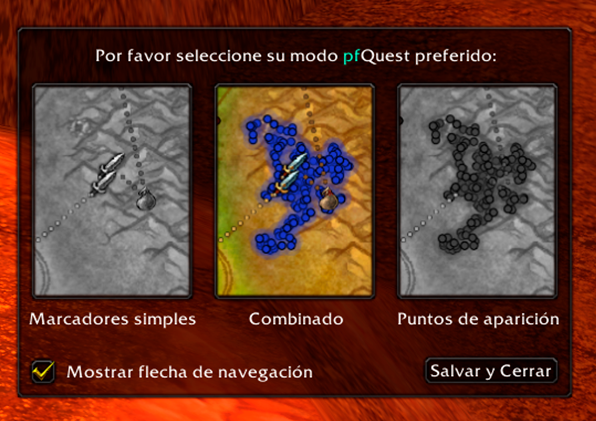

# pfQuest


Este es un addon para World of Warcraft Vanilla (1.12) y The Burning Crusade (2.4.3). Ayuda a los jugadores a localizar diversos objetos y misiones dentro del juego. El addon lee los objetivos de las misiones, los analiza y utiliza su base de datos interna para marcar las coincidencias encontradas tanto en el mapa del mundo como en el minimapa. Incluye una interfaz gráfica (GUI) para explorar todos los objetos conocidos. Si alguno de los elementos aún no está disponible en tu reino, verás un símbolo [?] junto a su nombre.

El addon no está diseñado para servir como guía de misiones o de recorrido; su objetivo es ofrecer una versión precisa, integrada en el juego, de [AoWoW](http://db.vanillagaming.org/) o [Wowhead](http://www.wowhead.com/). La versión para *Vanilla* utiliza la base de datos de [VMaNGOS](https://github.com/vmangos). La versión para *The Burning Crusade* emplea datos del proyecto [CMaNGOS](https://github.com/cmangos), con traducciones provenientes de [MaNGOS Extras](https://github.com/MangosExtras).

pfQuest es el sucesor de [ShaguQuest](https://shagu.org/ShaguQuest/) y ha sido escrito completamente desde cero. A diferencia de [ShaguQuest](https://shagu.org/ShaguQuest/), este addon no depende de ningún addon específico de mapas o de registro de misiones. Está diseñado para ser compatible tanto con la interfaz predeterminada como con cualquier otro addon.

# Traducción

Este repositorio contiene una traducción completa al español del addon pfQuest para World of Warcraft Classic, creado originalmente por Shagu. Sin su trabajo, esta traducción no existiría. Todo el crédito por el desarrollo original, la base de datos y la lógica del addon le pertenece.

Esta es una versión traduce únicamente los textos de la interfaz y el contenido mostrado al español. La funcionalidad, la base de datos y el comportamiento del addon permanecen intactos respecto al original.

> [!IMPORTANT]
>
> **Esta traducción solo trabaja el idioma español. No incluye otros idiomas.**
>
> ⚠️ Notas: Este es un proyecto no oficial y no está afiliado a Shagu.
>
>Para reportar errores relacionados con la traducción, abre un issue en este repositorio.
>Para problemas del addon original (funcionalidad, base de datos, etc.), dirígete al repositorio original de Shagu.

# Descargas
Puedes consultar la página de [[Últimos cambios]](https://github.com/shagu/pfQuest/commits/master) para ver qué ha cambiado recientemente.

## World of Warcraft: **Vanilla**
1. **[[Descargar pfQuest]](https://github.com/shagu/pfQuest/releases/latest/download/pfQuest-full.zip)**
2. Descomprime el archivo ZIP
3. Mueve la carpeta `pfQuest` a `Directorio-de-WoW\Interface\AddOns`
4. Reiniciar WoW
5. Establece «Script Memory» en «0» ([Como hacerlo](https://i.imgur.com/rZXwaK0.jpg))

 *Como opción, también puedes elegir una de las versiones reducidas. Estas versiones se limitan a un único idioma específico:
 [English](https://github.com/shagu/pfQuest/releases/latest/download/pfQuest-enUS.zip),
[한국인](https://github.com/shagu/pfQuest/releases/latest/download/pfQuest-koKR.zip),
[Français](https://github.com/shagu/pfQuest/releases/latest/download/pfQuest-frFR.zip),
[Deutsch](https://github.com/shagu/pfQuest/releases/latest/download/pfQuest-deDE.zip),
[中國人](https://github.com/shagu/pfQuest/releases/latest/download/pfQuest-zhCN.zip),
[Español](https://github.com/shagu/pfQuest/releases/latest/download/pfQuest-esES.zip),
[Русский](https://github.com/shagu/pfQuest/releases/latest/download/pfQuest-ruRU.zip)*

## World of Warcraft: **La Cruzada Ardiente**
1. **[[Descargar pfQuest]](https://github.com/shagu/pfQuest/releases/latest/download/pfQuest-full-tbc.zip)**
2. Descomprime el archivo ZIP
3. Mueve la carpeta `pfQuest-tbc` a `Directorio-de-WoW\Interface\AddOns`
4. Reiniciar WoW

\*) *Como opción, también puedes elegir una de las versiones reducidas. Estas versiones se limitan a un único idioma específico: [English](https://github.com/shagu/pfQuest/releases/latest/download/pfQuest-enUS-tbc.zip),
[한국인](https://github.com/shagu/pfQuest/releases/latest/download/pfQuest-koKR-tbc.zip),
[Français](https://github.com/shagu/pfQuest/releases/latest/download/pfQuest-frFR-tbc.zip),
[Deutsch](https://github.com/shagu/pfQuest/releases/latest/download/pfQuest-deDE-tbc.zip),
[中國人](https://github.com/shagu/pfQuest/releases/latest/download/pfQuest-zhCN-tbc.zip),
[Español](https://github.com/shagu/pfQuest/releases/latest/download/pfQuest-esES-tbc.zip),
[Русский](https://github.com/shagu/pfQuest/releases/latest/download/pfQuest-ruRU-tbc.zip)*

## World of Warcraft: **La Ira del Rey Exánime**

> [!IMPORTANT]
>
> **Esta es una versión BETA de pfQuest**
>
> Es compatible con un cliente de WotLK (3.3.5a), pero por ahora no incluye una base de datos de WotLK.
>
>Todo el contenido disponible se limita, por el momento, a Vanilla y TBC.

1. **[[Descargar pfQuest]](https://github.com/shagu/pfQuest/releases/latest/download/pfQuest-full-wotlk.zip)**
2. Descomprime el archivo ZIP
3. Mueve la carpeta `pfQuest-wotlk` a `Directorio-de-WoW\Interface\AddOns`
4. Reiniciar WoW

\*) *Como opción, también puedes elegir una de las versiones reducidas. Estas versiones se limitan a un único idioma específico: 
[English](https://github.com/shagu/pfQuest/releases/latest/download/pfQuest-enUS-wotlk.zip),
[한국인](https://github.com/shagu/pfQuest/releases/latest/download/pfQuest-koKR-wotlk.zip),
[Français](https://github.com/shagu/pfQuest/releases/latest/download/pfQuest-frFR-wotlk.zip),
[Deutsch](https://github.com/shagu/pfQuest/releases/latest/download/pfQuest-deDE-wotlk.zip),
[中國人](https://github.com/shagu/pfQuest/releases/latest/download/pfQuest-zhCN-wotlk.zip),
[Español](https://github.com/shagu/pfQuest/releases/latest/download/pfQuest-esES-wotlk.zip),
[Русский](https://github.com/shagu/pfQuest/releases/latest/download/pfQuest-ruRU-wotlk.zip)*

## Versión de desarrollo
La versión en desarrollo incluye bases de datos de todos los idiomas y expansiones del cliente. Dependiendo del nombre de la carpeta, se ejecutará tanto en modo «vanilla» como en modo «TBC». Debido a la cantidad de datos incluidos, esta versión conllevará un mayor consumo de memoria RAM y espacio en disco, así como tiempos de carga ligeramente más prolongados.

- Descargar mediante Git: [`https://github.com/shagu/pfQuest.git`](https://github.com/shagu/pfQuest.git)
- Descargar mediante el navegador: **[Archivo ZIP](https://github.com/shagu/pfQuest/archive/master.zip)**

## Controles
- Para cambiar los colores de los nodos en el mapa del mundo, **haz clic** en el nodo.
- Para eliminar del mapa las misiones ya completadas, haz **clic con la tecla \<Shift\> presionada** sobre el otorgante de la misión en el mapa del mundo.
- Para ocultar temporalmente los grupos en el mapa del mundo, mantén presionada la **tecla \<Ctrl\>**.
- Para ocultar temporalmente los nodos en el minimapa, coloca el cursor sobre él y mantén presionada la tecla **Ctrl**.
- Para mover el botón del minimapa, **arrastra** el icono mientras mantienes pulsada la tecla **\<shift\>**.
- Para mover la flecha, **arrastra** el marco manteniendo presionada la tecla **\<shift\>**.

## Uso de memoria de los complementos
El addon incluye una base de datos completa con todas las apariciones (spawns), objetos, ítems y misiones; por tanto, contiene una base de datos de gran tamaño (~80 MB, incluyendo todos los idiomas) que se carga en la memoria al iniciar el juego. No obstante, el consumo de memoria de pfQuest es constante y no aumenta con el paso del tiempo, por lo que no afecta negativamente al rendimiento. Dependiendo de la versión que descargues (especialmente en los paquetes completos), es posible que aparezca un aviso indicando que un addon está consumiendo demasiada memoria. Para eliminar este aviso, puedes establecer el límite de memoria para los addons en `0`, lo cual equivale a «sin límite». Esta opción se encuentra en la [pantalla de selección de personaje](https://i.imgur.com/rZXwaK0.jpg).

# Nodos del mapa y del minimapa


# Seguimiento automático

El complemento cuenta con 4 modos distintos que determinan cómo deben gestionarse los objetivos de misión nuevos o actualizados. Estos modos pueden seleccionarse en el menú desplegable situado en la parte superior derecha del mapa.

### Opción: Todas las misiones
Cada misión se mostrará y actualizará automáticamente en el mapa.

### Opción: Misiones seguidas
Solo las misiones seguidas (Shift + clic) se mostrarán y actualizarán automáticamente en el mapa.

### Opción: Selección manual
Solo se mostrarán los objetivos de misión que se hayan habilitado manualmente (mediante el botón «Mostrar» en el registro de misiones).
Los objetivos de misión completados seguirán eliminándose automáticamente del mapa.

### Opción: Ocultar misiones
Al igual que en la «Selección manual», los encomendadores de misiones no aparecerán automáticamente.
Además, los objetivos de misión completados permanecerán en el mapa. Este modo no altera ninguno de los nodos creados en el mapa.

# Explorador de bases de datos


La interfaz gráfica de la base de datos te permite marcar y explorar todas las entradas contenidas en la base de datos de pfQuest. Puedes abrirla haciendo clic en el icono de pfQuest en el minimapa o mediante el comando `/db show`. El navegador mostrará un máximo de 100 entradas a la vez en cada pestaña. Utiliza la rueda del ratón o las flechas de dirección (arriba/abajo) para desplazarte por la lista.

# Integración del registro de misiones
### Enlaces de misiones


En los servidores que admiten «enlaces de misión» (questlinks), al hacer clic en una misión seleccionada mientras mantienes presionada la tecla Shift (Mayús), se añadirá un enlace de misión al chat. Estos enlaces son similares a los conocidos enlaces de misión de TBC+ y son compatibles con los generados por [ShaguQuest](https://shagu.org/ShaguQuest/), [Questie](https://github.com/AeroScripts/QuestieDev) y [QuestLink](http://addons.us.to/addon/questlink-0). Ten en cuenta que algunos servidores (por ejemplo, Kronos) bloquean los enlaces de misión; en tales casos, deberás desactivar esta función en la configuración de pfQuest para que, en lugar de añadir un enlace, se muestre el nombre de la misión en el chat. Los enlaces de misión enviados entre usuarios de pfQuest son independientes del idioma (locale) y se basan en el ID de la misión.

La información emergente mostrará detalles sobre la misión, como tu estado actual en ella (nueva, en curso, ya completada), así como el texto del objetivo y la descripción completa de la misión. Además, se indican el nivel sugerido y el nivel mínimo.

### Botones del registro de misiones


El registro de misiones mostrará 4 botones adicionales en cada misión para facilitar su seguimiento manual. Estos botones permiten mostrar u ocultar misiones específicas en el mapa. Dichos botones no afectarán a las entradas que hayas añadido mediante el explorador de la base de datos.

**Mostrar**  
El botón «Mostrar» añadirá al mapa los objetivos de la misión actual.

**Esconder**  
El botón «Ocultar» eliminará del mapa la misión seleccionada actualmente.

**Limpiar**  
El botón «Limpiar» eliminará del mapa todos los nodos que hayan sido colocados por pfQuest.

**Reiniciar**  
El botón «Restablecer» restaurará la visibilidad predeterminada de los iconos para que coincida con los valores establecidos en el menú desplegable del mapa (por ejemplo, «Todas las misiones» de forma predeterminada).

# Chat/Macros CLI


El complemento cuenta con una interfaz de línea de comandos (CLI) que te permite crear fácilmente macros para mostrar tus hierbas o yacimientos mineros favoritos. Por ejemplo, si quieres visualizar todos los **yacimientos de hierro**, puedes escribir en el chat o crear una macro con el siguiente comando: `/db object Iron Deposit`. También puedes mostrar todos los yacimientos mineros en el mapa escribiendo: `/db track mines`. Esta función admite parámetros adicionales para especificar un rango de habilidad mínimo y máximo; por ejemplo, al usar `/db track mines 150 225`, se mostrarán todos los yacimientos que requieran un nivel de habilidad de entre 150 y 225. El parámetro `mines` puede sustituirse por otros, como `herbs`, `rares`, `chests`, `taxi`, entre muchos más, para mostrar los elementos correspondientes. Si el comando `/db` no te funciona, existen alias alternativos como `/shagu`, `pfquest` y `/pfdb`.

### Basic Commands
```
/db lock                Bloquear el seguimiento en el mapa
/db tracker             Mostrar rastreador en el mapa
/db journal             Mostrar diario de misiones
/db arrow               Mostrar flecha de misión
/db show                Mostrar interfaz de base de datos
/db config              Mostrar interfaz de configuración
/db locale              Mostrar las configuraciones regionales de los complementos
/db scan                Analiza el servidor en busca de objetos personalizados
```

### Búsqueda
```
/db reset               Recargar todas las misiones en el mapa
/db query               Consultar al servidor las misiones completadas
```

### Base de datos
```
/db unit <unit>         Busca unidades específicas por su nombre (p. ej., Thrall)
/db object <object>     Buscar gameobjects por nombre (p. ej., Mena de hierro)
/db item <item>         Busca unidades y objetos que suelten un objeto (p. ej., Tela rúnica)
/db vendor <item>       Busca vendedores que ofrezcan un objeto específico (p. ej., Flecha dentada)
/db quest <questname>   Busca una misión específica por su nombre
/db clean               Eliminar del mapa todos los resultados de búsqueda de la base de datos
```

### Tracking
```
/db track               Muestra una visión general de todas las listas que se pueden realizar un seguimiento
/db track clean         Limpia todas las listas seguidas de una sola vez
/db track <list>        Muestra todos los objetos de <list> en el mapa
/db track <list> clean  Elimina del mapa todos los objetos de <list>
```

**[Examples:](Ejemplos:)**
```
/db track mines         Muestra todas las minas en el mapa
/db track mines auto    Muestra todas las minas que se encuentran dentro del rango de habilidad actual del personaje.
/db track mines 50 150  Muestra todas las minas que requieren un nivel de habilidad de 50 a 150.
/db track mines clean   Elimina todas las minas del mapa
```

*Las listas de seguimiento disponibles actualmente son: `repair`, `mines`, `vendor`, `herbs`, `fish`, `meetingstone`, `rares`, `auctioneer`, `battlemaster`, `banker`, `chests`, `flight`, `stablemaster`, `innkeeper`, `spirithealer`, `mailbox`*
